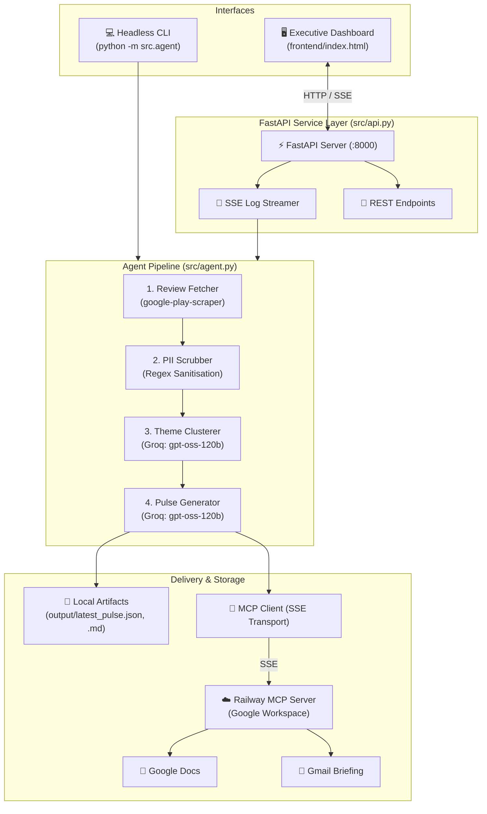

# 🚀 Grow Review AI Agent (MCP)

An intelligent, end-to-end customer feedback pipeline and executive dashboard designed for **Groww** (`com.nextbillion.groww`). The system automatically ingests public Google Play Store reviews, redacts all Personally Identifiable Information (PII), clusters feedback into strategic product themes using an LLM on Groq, generates a leadership-ready weekly pulse (≤250 words), and delivers it via **Google Docs** and **Gmail** through **Model Context Protocol (MCP)** servers over Server-Sent Events (SSE).

Includes a modern, dark-themed interactive executive dashboard with live terminal execution streaming, dynamic theme cluster filtering, date lookback synchronization, and direct Jira ticket dispatch.

---

## 🌟 Key Features

- **🛡️ 100% PII-Free Ingestion**: Scrapes public Play Store reviews without requiring user login or credentials; strips emails, phone numbers, UPI handles (`@okhdfcbank`, `@ybl`), and device identifiers before any LLM processing.
- **🧠 Intelligent Theme Clustering**: Uses `openai/gpt-oss-120b` on Groq to cluster raw reviews into **at most 5 high-impact themes** (*KYC & Onboarding*, *UPI & Payments*, *Statements & Tax*, *Withdrawals*, *App Performance*).
- **📋 Leadership Pulse Synthesis**: Generates concise (strictly ≤250 words) weekly summaries featuring top themes by volume, verbatim user quotes (no hallucinations), and 3 prioritized product action items.
- **🔌 Model Context Protocol (MCP) via SSE**: Connects over Server-Sent Events (SSE) to a live Railway-hosted Google Workspace MCP server (`https://gmailgoogledocmcpserver-production.up.railway.app/sse`) to create formatted Google Docs and send Gmail briefings.
- **🖥️ Dark-Themed Executive Dashboard**: A responsive web interface featuring:
  - **Review Theme Clustering Tabs**: Filter verbatim reviews across *All clusters*, *KYC & Onboarding*, *UPI & Payments*, *Statements & Tax*, *Withdrawals*, and *App Performance*.
  - **Date Lookback Synchronizer**: Interactive date picker with automatic calculation of rolling lookback weeks.
  - **Live Terminal Runner**: Real-time console terminal streaming pipeline execution logs via Server-Sent Events (SSE).
  - **Jira Ticket Dispatch**: One-click modal to escalate recurring customer pain points to engineering.
  - **API Connection Switcher**: Seamlessly toggle between local backend (`localhost:8000`) and cloud deployments.
- **⚡ Dual Execution Modes**: Run interactively through the web dashboard or execute headlessly via CLI for scheduled batch and cron runs.

---

## 🏗️ Architecture Overview



---

## 📋 Prerequisites

- **Python 3.11+**
- **Groq API Key** (for fast inference on `openai/gpt-oss-120b`)
- *(Optional)* **Live MCP Server** (defaults to deployed Railway Google Workspace server)

---

## ⚙️ Environment Configuration

Create a `.env` file from the provided `.env.example`:

```bash
cp .env.example .env
```

| Variable | Description | Default / Example |
|----------|-------------|-------------------|
| `GROQ_API_KEY` | API key from Groq Console (**Required**) | `gsk_...` |
| `LLM_MODEL` | LLM model for clustering and pulse generation | `openai/gpt-oss-120b` |
| `GROWW_APP_ID` | Package identifier for Groww on Google Play | `com.nextbillion.groww` |
| `REVIEW_LOOKBACK_WEEKS` | Default lookback period in weeks | `10` |
| `REVIEW_MAX_COUNT` | Maximum number of reviews to ingest per run | `500` |
| `PULSE_RECIPIENT_EMAIL` | Email address for Gmail draft/send delivery | `you@yourteam.com` |
| `GOOGLE_DOCS_MCP_URL` | SSE endpoint for Google Docs MCP server | `https://gmailgoogledocmcpserver-production.up.railway.app/sse` |
| `GMAIL_MCP_URL` | SSE endpoint for Gmail MCP server | `https://gmailgoogledocmcpserver-production.up.railway.app/sse` |
| `PORT` | Web server port (used by Uvicorn) | `8000` |

---

## 🚀 Quickstart

### 1. Clone & Set Up Virtual Environment

```bash
git clone <repository_url>
cd Grow_Review_AI_Agent_MCP

# Create and activate virtual environment
python -m venv .venv

# Windows:
.venv\Scripts\activate

# macOS / Linux:
source .venv/bin/activate

# Install dependencies
pip install -r requirements.txt
```

### 2. Launch the Interactive Web Dashboard

Start the FastAPI application with auto-reloading:

```bash
uvicorn src.api:app --reload --port 8000
```

Open your browser and navigate to:
👉 **[http://localhost:8000](http://localhost:8000)**

- Click **Run Agent Pipeline** to trigger a real-time ingestion and clustering run.
- Watch live pipeline execution logs stream in the built-in terminal.
- Filter customer sentiment and verbatim quotes by clicking on theme tabs (*KYC & Onboarding*, *UPI & Payments*, etc.).
- Adjust the date range using the interactive date picker.
- Click **Create Jira Ticket** to push high-priority action items.

### 3. Headless CLI Execution

To run the pipeline as a background script or cron job without the web interface:

```bash
python -m src.agent
```

The pipeline fetches reviews, scrubs PII, clusters themes, creates a Google Doc / Gmail draft via MCP, and saves local outputs to `output/`:
- `output/pulse_YYYY-MM-DD.md`: Executive Markdown summary
- `output/latest_pulse.json`: Typed pulse payload
- `output/latest_reviews.json`: Anonymized and categorized review dataset

---

## 🔌 API Reference

The FastAPI service exposes the following endpoints:

| Endpoint | Method | Description |
|----------|--------|-------------|
| `GET /api/health` | GET | Healthcheck returning service readiness and MCP status |
| `GET /api/connectors` | GET | Diagnostic check for Groq, Google Docs MCP, Gmail MCP, and Jira |
| `GET /api/pulse/latest` | GET | Retrieves the latest synthesized `WeeklyPulse` JSON payload |
| `GET /api/reviews` | GET | Retrieves latest cleaned reviews with optional `theme` filtering |
| `POST /api/run-agent/stream` | POST | Triggers the agent pipeline and streams real-time logs via **SSE** |
| `POST /api/mcp/sync-docs` | POST | Dispatches the current pulse to Google Docs via MCP |
| `POST /api/mcp/draft-gmail` | POST | Prepares a pulse executive briefing in Gmail via MCP |
| `POST /api/jira/create` | POST | Creates a Jira ticket from flagged customer feedback |
| `GET /` | GET | Serves the interactive executive dashboard (`frontend/index.html`) |

---

## ☁️ Deployment Guide

### Option 1: Full-Stack Deployment on Railway (Recommended)

Deploy both the FastAPI backend and web dashboard as a unified container:

1. Connect your repository to [Railway](https://railway.app).
2. Set the following environment variables in your Railway dashboard:
   - `GROQ_API_KEY`: Your Groq API key
   - `PULSE_RECIPIENT_EMAIL`: Target email for Gmail delivery
   - `GOOGLE_DOCS_MCP_URL`: `https://gmailgoogledocmcpserver-production.up.railway.app/sse`
   - `GMAIL_MCP_URL`: `https://gmailgoogledocmcpserver-production.up.railway.app/sse`
3. Railway automatically detects the [`Dockerfile`](file:///d:/Grow_Review_AI_Agent_MCP/Dockerfile) or [`Procfile`](file:///d:/Grow_Review_AI_Agent_MCP/Procfile) and starts `uvicorn src.api:app --host 0.0.0.0 --port $PORT`.
4. Your application will be live with both the API and dashboard served at your Railway public domain.

### Option 2: Split Deployment (Vercel Frontend + Railway Backend)

- **Frontend on Vercel**: Deploy the repository on Vercel using the preconfigured [`vercel.json`](file:///d:/Grow_Review_AI_Agent_MCP/vercel.json).
- **Backend on Railway**: Deploy `src/api.py` on Railway.
- **Connecting Both**: Open the frontend on Vercel, click **Connect API** in the header, and enter your Railway backend URL (e.g., `https://groww-pulse-api.up.railway.app`). The dashboard will save this in `localStorage` and route all API calls and SSE streams to your Railway instance.

---

## 🧪 Testing & Quality Assurance

The codebase includes comprehensive unit and integration tests covering data ingestion, PII redaction, theme clustering constraints, pulse word counts, and API endpoints.

Run the test suite:

```bash
pytest tests/
```

To run with coverage reporting:

```bash
pytest --cov=src --cov-report=term-missing tests/
```

**Test Suite Coverage (18 passing tests):**
- `tests/test_scrubber.py`: Ensures phone numbers, email addresses, and UPI IDs are reliably redacted.
- `tests/test_clusterer.py`: Verifies ≤5 theme constraint and robust error recovery from malformed LLM responses.
- `tests/test_pulse_generator.py`: Verifies verbatim quote selection, action idea generation, and ≤250-word enforcement.
- `tests/test_fetcher.py`: Validates date lookback filtering, deduplication, and exclusion of user identity fields.
- `tests/test_api.py`: Validates FastAPI health checks, connectors, and review filtering endpoints.

---

## 📁 Project Structure

```
Grow_Review_AI_Agent_MCP/
├── frontend/
│   └── index.html               # Stitch-inspired dark executive dashboard
├── src/
│   ├── agent.py                 # Core pipeline orchestrator with step callbacks
│   ├── api.py                   # FastAPI server with REST + SSE endpoints
│   ├── ingestion/
│   │   ├── fetcher.py           # Google Play Store review scraper
│   │   └── models.py            # Pydantic schemas (Review, CleanReview)
│   ├── processing/
│   │   ├── scrubber.py          # Regex-based PII redaction engine
│   │   ├── clusterer.py         # LLM theme clustering (<=5 themes)
│   │   └── pulse_generator.py   # Pulse synthesis (<=250 words, verbatim quotes)
│   ├── mcp/
│   │   ├── router.py            # MCP SSE client and tool dispatcher
│   │   ├── docs_mcp.py          # Google Docs tool wrapper
│   │   └── gmail_mcp.py         # Gmail tool wrapper
│   └── utils/
│       ├── config.py            # Configuration loader
│       └── prompts.py           # LLM prompt templates
├── tests/                       # Complete automated test suite
├── output/                      # Generated Markdown & JSON artifacts
├── Dockerfile                   # Railway container configuration
├── Procfile                     # Process runner for cloud platforms
├── railway.json                 # Railway service config
├── vercel.json                  # Vercel static routing config
├── requirements.txt             # Project dependencies
└── README.md                    # Project documentation
```

---

## 📄 License

This project is created for evaluation and demonstration purposes. All review ingestion complies with public Google Play Store guidelines and operates strictly on anonymous public data.
