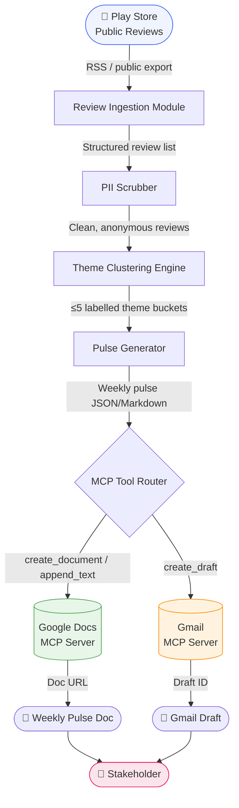
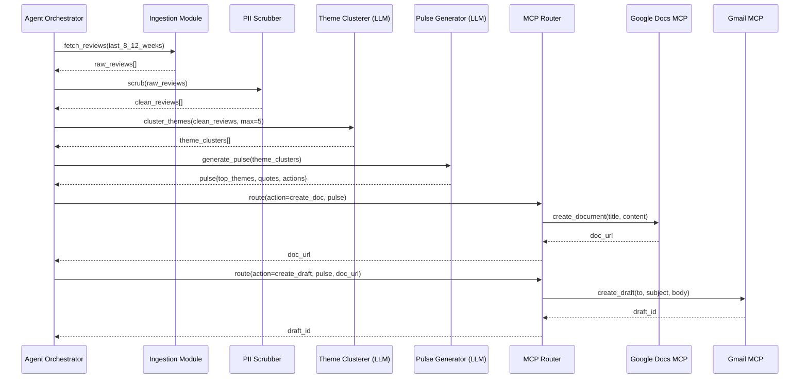

# Architecture — Grow Review AI Agent (MCP)

## 1. System Overview

The Grow Review AI Agent is a **pipeline-style AI agent** that ingests public Groww app reviews, clusters them into themes using an LLM, produces a structured weekly pulse, and delivers it via Google Docs and Gmail — entirely through **MCP (Model Context Protocol) servers**.

```
┌─────────────────────────────────────────────────────────────────────────┐
│                        Grow Review AI Agent                             │
│                                                                         │
│  ┌──────────┐   ┌───────────┐   ┌──────────────┐   ┌───────────────┐  │
│  │  Review  │──▶│ Ingestion │──▶│  LLM Engine  │──▶│   Delivery    │  │
│  │  Source  │   │  Layer    │   │  (Theme +    │   │  Layer (MCP)  │  │
│  │(Play     │   │           │   │   Pulse Gen) │   │               │  │
│  │ Store)   │   │           │   │              │   │ Google Docs   │  │
│  └──────────┘   └───────────┘   └──────────────┘   │ Gmail Draft   │  │
│                                                      └───────────────┘  │
└─────────────────────────────────────────────────────────────────────────┘
```

---

## 2. High-Level Architecture Diagram



---

## 3. Component Breakdown

### 3.1 Review Ingestion Module

**Responsibility:** Fetch and normalise raw review data from the Groww Play Store listing.

| Attribute | Detail |
|-----------|--------|
| **Source** | Google Play Store public page for `com.nextbillion.groww` |
| **Method** | Public RSS feed / `google-play-scraper` (ToS-compliant, no login) |
| **Time Window** | Last **8–12 weeks** of reviews |
| **Fields Extracted** | `rating` (1–5), `text`, `date`, `title` (if available) |
| **Output** | List of structured `Review` objects (JSON) |

**Review Schema:**
```json
{
  "id": "sha256_of_text",
  "rating": 3,
  "date": "2026-09-15",
  "text": "App crashes on the portfolio screen every time I open it.",
  "title": null
}
```

> **Note:** No reviewer username, email, device ID, or any other PII is stored.

---

### 3.2 PII Scrubber

**Responsibility:** Strip any personally identifiable information before the data touches the LLM or any output artifact.

- Regex-based removal of email addresses, phone numbers, and device IDs
- Reviewer display names are never captured (not in the schema above)
- Output is a sanitised list of `CleanReview` objects

---

### 3.3 Theme Clustering Engine

**Responsibility:** Group reviews into **at most 5 named themes** using an LLM prompt.

| Attribute | Detail |
|-----------|--------|
| **Model** | `openai/gpt-oss-120b` on **Groq** (set via `LLM_MODEL` env var; called through the `groq` Python SDK) |
| **Strategy** | Zero-shot or few-shot prompt asking the model to assign each review to one of ≤5 predefined/emergent themes |
| **Candidate Themes** | `Onboarding`, `KYC`, `Payments`, `Portfolio / Statements`, `Withdrawals` (adjusted per review corpus) |
| **Output** | `ThemeCluster[]` — each with theme name, review count, and list of review IDs |

**Prompt Template (simplified):**
```
You are a product analyst. Given the following Groww app reviews,
assign each to one of the themes: [Onboarding, KYC, Payments, Statements, Withdrawals].
Use at most 5 themes. Return JSON only.

Reviews:
{{reviews_json}}
```

---

### 3.4 Pulse Generator

**Responsibility:** Synthesise the theme clusters into a structured, ≤250-word weekly pulse.

**Output Schema:**
```json
{
  "week_ending": "2026-10-05",
  "top_themes": [
    { "name": "Payments", "count": 42, "summary": "..." },
    { "name": "KYC",      "count": 31, "summary": "..." },
    { "name": "Withdrawals", "count": 18, "summary": "..." }
  ],
  "user_quotes": [
    "My SIP payment failed twice without any error message.",
    "KYC kept asking for the same document three times.",
    "Withdrawal took 6 days, no update in the app."
  ],
  "action_ideas": [
    "Add in-app alerts for failed SIP payments with retry CTAs.",
    "Introduce KYC status tracker so users know which step failed.",
    "Surface withdrawal ETA and status on the home screen."
  ]
}
```

> Quotes are selected verbatim from real reviews and must already be PII-free.

---

### 3.5 MCP Tool Router

**Responsibility:** Act as the single interface between the agent and external services, routing calls to the correct MCP server.

```
MCP Tool Router
├── google-docs-mcp
│   ├── create_document(title, content)
│   └── append_text(doc_id, content)
└── gmail-mcp
    └── create_draft(to, subject, body)
```

- **No raw Google API / OAuth code** is written in the agent itself.
- The router selects the correct MCP server based on the action type.
- Auth, token refresh, and HTTP plumbing are handled entirely by the MCP server runtime.

---

### 3.6 Google Docs MCP Server

**Responsibility:** Create or update the weekly pulse document in Google Docs.

| MCP Tool | Parameters | Result |
|----------|------------|--------|
| `create_document` | `title`, `markdown_content` | Returns `doc_id`, `doc_url` |
| `append_text` | `doc_id`, `text` | Appends to existing doc |

**Document Format:**
```
📊 Groww Weekly Pulse — Week of Oct 5, 2026
───────────────────────────────────────────

🔥 Top Themes
  1. Payments (42 reviews)
  2. KYC (31 reviews)
  3. Withdrawals (18 reviews)

💬 User Voices
  "My SIP payment failed twice without any error message."
  ...

✅ Action Ideas
  1. Add in-app alerts for failed SIP payments with retry CTAs.
  ...
```

---

### 3.7 Gmail MCP Server

**Responsibility:** Create a Gmail draft containing the pulse or a link to the Google Doc.

| MCP Tool | Parameters | Result |
|----------|------------|--------|
| `create_draft` | `to`, `subject`, `body` | Returns `draft_id` |

**Draft Email Format:**
```
To:      you@yourteam.com
Subject: 📊 Groww Weekly Pulse — Oct 5, 2026

Hi team,

This week's review pulse is ready:
👉 [View in Google Docs] (doc_url)

Quick Summary:
- Top theme: Payments (42 reviews)
- KYC friction still high (31 reviews)
- Withdrawal delays flagged (18 reviews)

See the full pulse for verbatim quotes and action ideas.
```

---

## 4. Data Flow (Sequence)



---

## 5. Project File Structure

```
grow-review-ai-agent-mcp/
│
├── docs/
│   ├── problem-statement.txt       # Original brief
│   ├── problemStatement.md         # Structured problem statement
│   └── architecture.md             # This document
│
├── src/
│   ├── agent.py                    # Orchestrator — wires all modules together
│   │
│   ├── ingestion/
│   │   ├── __init__.py
│   │   ├── fetcher.py              # Pulls reviews from Play Store (public)
│   │   └── models.py               # Review / CleanReview dataclasses
│   │
│   ├── processing/
│   │   ├── __init__.py
│   │   ├── scrubber.py             # PII removal logic
│   │   ├── clusterer.py            # LLM-based theme clustering
│   │   └── pulse_generator.py      # Builds the weekly pulse JSON
│   │
│   ├── mcp/
│   │   ├── __init__.py
│   │   ├── router.py               # Routes to the correct MCP server
│   │   ├── docs_mcp.py             # Google Docs MCP client wrapper
│   │   └── gmail_mcp.py            # Gmail MCP client wrapper
│   │
│   └── utils/
│       ├── __init__.py
│       ├── prompts.py              # LLM prompt templates
│       └── config.py               # Env vars, constants (MCP endpoints, etc.)
│
├── tests/
│   ├── test_scrubber.py
│   ├── test_clusterer.py
│   └── test_pulse_generator.py
│
├── config/
│   └── mcp_servers.json            # MCP server endpoint configuration
│
├── .env.example                    # Template for required environment variables
├── requirements.txt                # Python dependencies
└── README.md                       # Setup and run instructions
```

---

## 6. Technology Stack

| Layer | Technology | Rationale |
|-------|------------|-----------|
| **Language** | Python 3.11+ | Broad LLM SDK support, fast iteration |
| **Review Ingestion** | `google-play-scraper` (PyPI) | Public API, no login required, ToS-compliant |
| **LLM** | `openai/gpt-oss-120b` on **Groq** via `LLM_MODEL` env var | High-capacity model served on Groq; inference speed ideal for batch review processing |
| **LLM Client** | `groq` Python SDK | Official Groq client; OpenAI-compatible interface — model is swappable via `LLM_MODEL` without code changes |
| **MCP Runtime** | MCP SDK (Python) | First-class MCP server interaction |
| **Google Docs** | Google Docs MCP Server | MCP-first requirement |
| **Gmail** | Gmail MCP Server | MCP-first requirement |
| **Config** | `python-dotenv` | Keeps secrets out of source code |
| **Testing** | `pytest` | Standard, lightweight test runner |

---

## 7. MCP Configuration

`config/mcp_servers.json` defines the registered MCP servers the router discovers at startup:

```json
{
  "servers": [
    {
      "name": "google-docs-mcp",
      "transport": "stdio",
      "command": "npx",
      "args": ["-y", "@modelcontextprotocol/server-google-docs"],
      "env": {
        "GOOGLE_CLIENT_ID": "${GOOGLE_CLIENT_ID}",
        "GOOGLE_CLIENT_SECRET": "${GOOGLE_CLIENT_SECRET}"
      }
    },
    {
      "name": "gmail-mcp",
      "transport": "stdio",
      "command": "npx",
      "args": ["-y", "@modelcontextprotocol/server-gmail"],
      "env": {
        "GOOGLE_CLIENT_ID": "${GOOGLE_CLIENT_ID}",
        "GOOGLE_CLIENT_SECRET": "${GOOGLE_CLIENT_SECRET}"
      }
    }
  ]
}
```

> Credentials are injected from `.env` at runtime. No credentials are hardcoded.

---

## 8. Key Design Decisions

| Decision | Choice | Reason |
|----------|--------|--------|
| **MCP-first integration** | MCP servers for Docs & Gmail | Mandated by problem statement; avoids bespoke OAuth/REST plumbing |
| **PII scrubbing before LLM** | Pre-processing step | Prevents PII from leaking into any artifact, even LLM context |
| **Max 5 themes** | Hard constraint in prompt | Keeps the pulse scannable; mirrors problem statement |
| **Verbatim quotes** | Pulled directly from review text | No invented or paraphrased wording, as required |
| **≤250-word pulse** | Enforced in pulse generator prompt | Leadership-friendly, scannable format |
| **Anonymous review IDs** | SHA-256 of review text | Enables deduplication without storing PII |
| **Weekly cadence** | Triggered manually or via cron | Fits "weekly pulse" framing; cron keeps it hands-free |

---

## 9. Constraints Summary

| Constraint | Enforcement Point |
|------------|------------------|
| Public reviews only | `fetcher.py` — no authenticated store endpoints |
| No PII in artifacts | `scrubber.py` runs before clustering and pulse generation |
| ≤5 themes | Hard-coded in clusterer prompt and validation |
| ≤250-word pulse | Word-count check in `pulse_generator.py` |
| MCP-only for Docs/Gmail | `router.py` — no direct Google API calls anywhere |
| Verbatim quotes | Selected from `clean_reviews[]`, not LLM-generated |
