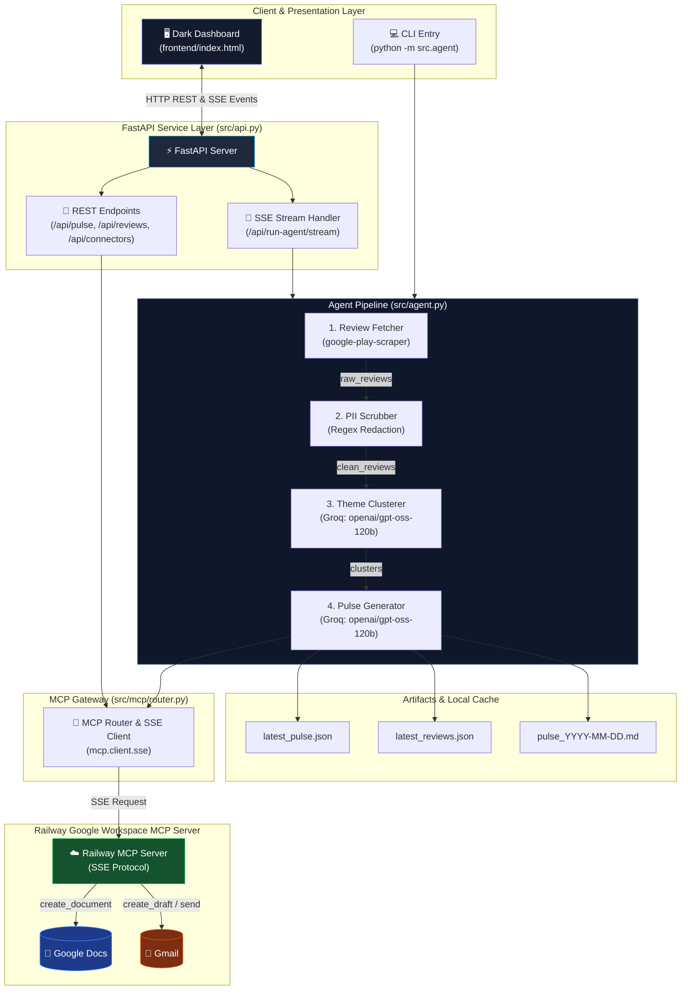
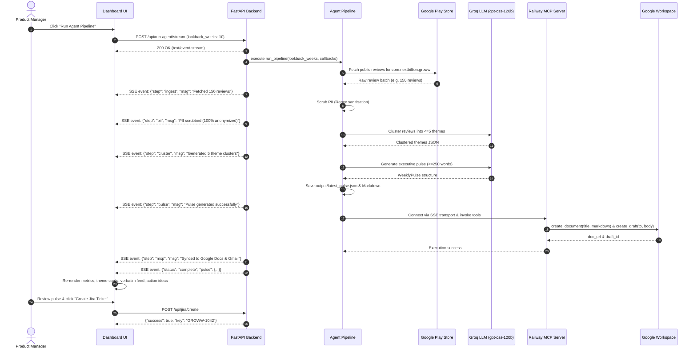

# Architecture — Grow Review AI Agent (MCP)

## 1. System Overview

The **Grow Review AI Agent** is an end-to-end intelligence system that ingests public Google Play Store reviews for the Groww app (`com.nextbillion.groww`), scrubs all personally identifiable information (PII), clusters reviews into at most 5 strategic themes using an LLM, generates an executive weekly pulse (≤250 words) with verbatim quotes and action ideas, and delivers it via Google Docs and Gmail using **Model Context Protocol (MCP)** servers over Server-Sent Events (SSE).

The system provides dual interfaces:
1. **Interactive Web Dashboard (`frontend/index.html`)**: A modern dark-mode frontend featuring real-time SSE execution logs, dynamic theme clustering filters, date lookback synchronisation, verbatim quote analysis, and Jira ticket creation.
2. **FastAPI Backend (`src/api.py`)**: A production-ready API service providing streaming agent execution endpoints, real-time connector health monitoring, on-demand MCP document/email dispatch, and static frontend hosting.
3. **CLI Orchestrator (`src/agent.py`)**: A standalone terminal runner for scheduled cron runs or batch operations.

```
┌──────────────────────────────────────────────────────────────────────────────────────────────────┐
│                                   Grow Review AI Agent System                                    │
│                                                                                                  │
│  ┌─────────────────────────┐         ┌───────────────────────────────────────────────────────┐   │
│  │  Client Layer           │         │  FastAPI API & Streaming Service                      │   │
│  │  - Web Dashboard        │────────▶│  - GET  /api/health            - GET /api/pulse/latest│   │
│  │  - CLI Pipeline         │         │  - POST /api/run-agent/stream  - GET /api/reviews     │   │
│  └─────────────────────────┘         │  - POST /api/mcp/sync-docs     - POST /api/jira/create│   │
│                                      └──────────────────────────┬────────────────────────────┘   │
│                                                                 │                                │
│                                      ┌──────────────────────────▼────────────────────────────┐   │
│                                      │  Core Agent Pipeline (src/agent.py)                   │   │
│                                      │  ┌──────────┐  ┌──────────┐  ┌──────────┐  ┌────────┐ │   │
│                                      │  │ Fetcher  │─▶│ Scrubber │─▶│ Clusterer│─▶│ Pulse  │ │   │
│                                      │  │(PlayStore│  │ (PII Red)│  │ (Groq LLM│  │ (Groq) │ │   │
│                                      │  └──────────┘  └──────────┘  └──────────┘  └────┬───┘ │   │
│                                      └─────────────────────────────────────────────────┼─────┘   │
│                                                                                        │         │
│  ┌─────────────────────────────────────────────────────────────────────────────────────▼──────┐  │
│  │  Delivery Layer — Model Context Protocol (MCP) via SSE                                      │  │
│  │  Railway MCP Server (https://gmailgoogledocmcpserver-production.up.railway.app/sse)        │  │
│  │  - google_docs_create_document / append_text  ──▶  Live Google Doc                          │  │
│  │  - gmail_create_draft / gmail_send_message    ──▶  Gmail Pulse Delivery                     │  │
│  │  - Local Fallback Cache                       ──▶  output/latest_pulse.json & Markdown      │  │
│  └────────────────────────────────────────────────────────────────────────────────────────────┘  │
└──────────────────────────────────────────────────────────────────────────────────────────────────┘
```

---

## 2. High-Level Architecture Diagram



---

## 3. Component Breakdown

### 3.1 Review Ingestion Module (`src/ingestion/`)

**Responsibility:** Fetch public Google Play Store reviews for `com.nextbillion.groww` and normalise them into structured `Review` models.

| Attribute | Detail |
|-----------|--------|
| **Source** | Google Play Store listing for `com.nextbillion.groww` |
| **Method** | `google-play-scraper` (ToS-compliant public scraping, zero login required) |
| **Lookback Window** | Dynamically selectable: 1 to 52 weeks (default: 10–12 weeks) |
| **Fields Extracted** | `id` (SHA-256 hash of review text), `rating` (1–5), `date`, `text`, `title` |
| **Anonymization** | Reviewer display names, user IDs, and profile images are dropped at ingestion time |

**Schema (`src/ingestion/models.py`):**
```python
class Review(BaseModel):
    id: str
    rating: int
    date: date
    text: str
    title: str | None = None
```

---

### 3.2 PII Scrubber (`src/processing/scrubber.py`)

**Responsibility:** Guarantee that zero personally identifiable information enters the LLM or any generated document.

- Evaluates review text against regex patterns for email addresses, phone numbers, UPI IDs (`user@okhdfcbank`, `user@ybl`), and device identifiers.
- Replaces matches with `[REDACTED]`.
- Filters out low-signal reviews where >50% of the content is redacted.
- Emits `CleanReview` objects.

---

### 3.3 Theme Clustering Engine (`src/processing/clusterer.py`)

**Responsibility:** Group scrubbed reviews into **at most 5 high-signal product themes**.

| Attribute | Detail |
|-----------|--------|
| **Model** | `openai/gpt-oss-120b` hosted on **Groq** (or configured via `LLM_MODEL`) |
| **Batching** | Batches reviews into chunks (≤150 reviews) to avoid context limit penalties |
| **Candidate Themes** | Emergent or canonical buckets: `Onboarding & KYC`, `Payments & UPI`, `Statements & Tax`, `Withdrawals & Settlements`, `App Performance` |
| **Constraint Enforcement** | Strict validation ensures ≤5 theme buckets are returned. Any overflow is aggregated into the closest category |

**Output Cluster Schema:**
```python
class ThemeCluster(BaseModel):
    name: str
    review_ids: list[str]
    count: int
    summary: str
```

---

### 3.4 Pulse Generator (`src/processing/pulse_generator.py`)

**Responsibility:** Synthesise clustered feedback into an executive-level summary formatted for leadership.

| Constraint | Implementation Detail |
|------------|-----------------------|
| **≤250 Words** | Strictly enforced by prompt and validated by word-count guards |
| **Verbatim Quotes** | Exactly 3 representative user quotes selected verbatim from `CleanReview` instances |
| **Action Ideas** | 3 concrete, prioritized product improvement recommendations |
| **Top Themes** | Top 3 clusters sorted by review count with concise summaries |

**Output Schema:**
```python
class WeeklyPulse(BaseModel):
    week_ending: date
    top_themes: list[ThemeCluster]
    user_quotes: list[str]
    action_ideas: list[str]
    word_count: int
```

---

### 3.5 Core Pipeline Orchestrator (`src/agent.py`)

**Responsibility:** Sequentially execute ingestion, scrubbing, clustering, pulse synthesis, artifact caching, and MCP delivery.

- Accepts progress callbacks (`step_callback(step_id, message, status)`) to enable real-time SSE updates to web clients.
- Writes structured artifacts to disk:
  - `output/pulse_YYYY-MM-DD.md`: Human-readable Markdown summary.
  - `output/latest_pulse.json`: Typed JSON pulse representation for the dashboard.
  - `output/latest_reviews.json`: Recent cleaned reviews with assigned theme labels for dashboard filtering.
- Connects to the MCP router for downstream Google Docs and Gmail dispatch, gracefully degrading to local persistence if remote services are unreachable.

---

### 3.6 FastAPI API & Streaming Layer (`src/api.py`)

**Responsibility:** Expose a resilient, asynchronous HTTP service for client interaction.

| Endpoint | Method | Description |
|----------|--------|-------------|
| `/api/health` | GET | Returns service status, Groq API readiness, and MCP connection status |
| `/api/connectors` | GET | Validates connectivity to Groq, Google Docs MCP, Gmail MCP, and Jira |
| `/api/pulse/latest` | GET | Retrieves the most recently generated `WeeklyPulse` JSON payload |
| `/api/reviews` | GET | Fetches latest cleaned reviews filtered by lookback or theme category |
| `/api/run-agent/stream` | POST | Triggers the agent pipeline and streams real-time execution logs via Server-Sent Events (SSE) |
| `/api/mcp/sync-docs` | POST | Dispatches the latest pulse to the Google Docs MCP server |
| `/api/mcp/draft-gmail` | POST | Creates a Gmail draft or sends a pulse briefing via the Gmail MCP server |
| `/api/jira/create` | POST | Creates a simulated or webhook-backed Jira ticket for flagged review issues |
| `/` | GET | Serves the interactive static dashboard (`frontend/index.html`) |

---

### 3.7 Interactive Web Dashboard (`frontend/index.html`)

**Responsibility:** Provide product managers and engineering leads with a zero-friction, dark-themed command center.

- **Theme Cluster Selector**: Interactive tab controls allowing one-click filtering (`All clusters`, `KYC & Onboarding`, `UPI & Payments`, `Statements & Tax`, `Withdrawals`, `App Performance`).
- **Date Lookback Synchronizer**: Interactive native date picker allowing custom end-date selection with automatic calculation of rolling lookback weeks.
- **Live Terminal & SSE Runner**: Real-time console terminal streaming agent pipeline execution logs as they happen.
- **Verbatim Voice Feed**: Shows authentic, anonymized user quotes with star ratings and sentiment badges.
- **Action Items & Jira Dispatch**: Leadership-ready recommendations with direct one-click "Create Jira Ticket" modal.
- **Dynamic API Switcher**: Configurable modal allowing instant connection switching between `localhost:8000` and remote Railway deployment URLs.

---

### 3.8 MCP Gateway & SSE Client (`src/mcp/router.py`, `docs_mcp.py`, `gmail_mcp.py`)

**Responsibility:** Standardized communication with external services strictly via the **Model Context Protocol (MCP)**.

- **Transport**: Utilizes `mcp.client.sse.sse_client` and `ClientSession` over HTTP/SSE.
- **Remote Host**: Connects to the deployed Railway Google Workspace MCP server:
  `https://gmailgoogledocmcpserver-production.up.railway.app/sse`
- **Dynamic Tool Discovery**: Queries available server tools at runtime:
  - `google_docs_create_document`: Creates new Google Docs with formatted pulse markdown.
  - `google_docs_append_text`: Appends content to existing documents.
  - `gmail_create_draft`: Prepares drafted email summaries for review.
  - `gmail_send_message`: Directly sends executive notifications to `PULSE_RECIPIENT_EMAIL`.
- **Fault-Tolerance**: If MCP connectivity fails or credentials expire, the pipeline logs a warning and stores the output locally in `output/` without failing the user request.

---

## 4. End-to-End Data Flow



---

## 5. Repository Structure

```
Grow_Review_AI_Agent_MCP/
│
├── .env                              # Active environment configuration
├── .env.example                      # Template for environment variables
├── Dockerfile                        # Multi-stage production container
├── Procfile                          # Process file for Railway deployment
├── railway.json                      # Railway deployment configuration
├── vercel.json                       # Vercel deployment configuration
├── requirements.txt                  # Python dependencies
├── README.md                         # Project overview and quickstart guide
│
├── docs/
│   ├── architecture.md               # System architecture and design (this file)
│   ├── implementation-plan.md        # Step-by-step progress tracker
│   └── problemStatement.md          # Problem context and requirements
│
├── frontend/
│   └── index.html                    # Modern, responsive dark-mode dashboard
│
├── src/
│   ├── __init__.py
│   ├── agent.py                      # Core pipeline orchestrator with step hooks
│   ├── api.py                        # FastAPI server with REST + SSE endpoints
│   │
│   ├── ingestion/
│   │   ├── __init__.py
│   │   ├── fetcher.py                # Google Play Store review scraper
│   │   └── models.py                 # Pydantic data schemas (Review, CleanReview)
│   │
│   ├── processing/
│   │   ├── __init__.py
│   │   ├── scrubber.py               # PII sanitisation and redaction
│   │   ├── clusterer.py              # LLM theme clustering engine
│   │   └── pulse_generator.py        # Executive weekly pulse synthesis
│   │
│   ├── mcp/
│   │   ├── __init__.py
│   │   ├── router.py                 # MCP client and tool router (SSE transport)
│   │   ├── docs_mcp.py               # Google Docs MCP wrappers
│   │   └── gmail_mcp.py              # Gmail MCP wrappers
│   │
│   └── utils/
│       ├── __init__.py
│       ├── config.py                 # Centralised settings & env var parser
│       └── prompts.py                # LLM system and user prompt definitions
│
├── output/                           # Generated pulse outputs and cached data
│   ├── latest_pulse.json             # Structured pulse JSON for dashboard
│   ├── latest_reviews.json           # Filterable reviews for dashboard
│   └── pulse_YYYY-MM-DD.md           # Rendered pulse markdown
│
├── tests/                            # Automated test suite (18 tests)
│   ├── __init__.py
│   ├── test_api.py                   # FastAPI endpoint and health tests
│   ├── test_fetcher.py               # Ingestion and date filtering tests
│   ├── test_scrubber.py              # PII redaction and filtering tests
│   ├── test_clusterer.py             # Theme parsing and constraint tests
│   └── test_pulse_generator.py       # Quote selection and word-count tests
│
└── config/
    └── mcp_servers.json              # MCP server definitions
```

---

## 6. Technology Stack

| Layer | Technology | Version / Spec | Purpose |
|-------|------------|----------------|---------|
| **Runtime** | Python | `3.11+` | Core execution environment |
| **API Framework** | FastAPI | `0.115.0+` | High-performance asynchronous REST & SSE backend |
| **ASGI Server** | Uvicorn | `0.30.0+` | ASGI production server |
| **LLM Inference** | Groq SDK | `0.9.0+` | Fast inference on `openai/gpt-oss-120b` |
| **MCP SDK** | `mcp` | `1.1.2+` | Official Python Model Context Protocol client |
| **MCP Transport** | SSE (`mcp.client.sse`) | HTTP Server-Sent Events | Standardised remote server communication |
| **Data Scraping** | `google-play-scraper`| `1.2.4+` | ToS-compliant public app review ingestion |
| **Validation** | Pydantic | `2.8.0+` | Strict schema validation and typing |
| **Frontend UI** | HTML5 / Vanilla CSS3 / JS | ES6+ Modern | Zero-build dark-mode interactive dashboard |
| **Containerization**| Docker | OCI Spec | Portable Railway deployment container |
| **Testing** | Pytest | `8.0.0+` | Automated test suite (18 unit/integration tests) |

---

## 7. Model Context Protocol (MCP) Integration

The agent interfaces with Google Workspace strictly through the Model Context Protocol:

```
[Agent Router (src/mcp/router.py)]
              │
              │  SSE Transport over HTTPS
              ▼
[Railway MCP Server: https://gmailgoogledocmcpserver-production.up.railway.app/sse]
              │
      ┌───────┴────────────────────────┐
      ▼                                ▼
[Google Docs MCP Tools]      [Gmail MCP Tools]
- google_docs_create_document - gmail_create_draft
- google_docs_append_text    - gmail_send_message
```

### Connection Flow
1. The agent initializes `sse_client(GOOGLE_DOCS_MCP_URL)` within an asynchronous context.
2. The MCP client performs the protocol handshake and queries tool listings using `session.list_tools()`.
3. Calls to `create_document` deliver the full Markdown weekly pulse directly to Google Drive.
4. Calls to `create_draft` or `send_message` prepare a formatted executive briefing in Gmail addressed to `PULSE_RECIPIENT_EMAIL`.
5. If the remote MCP server is offline, the client logs an error, falls back to local JSON/Markdown disk storage, and returns a user-friendly status code.

---

## 8. Deployment Architecture

### Deployment Model: Railway (Full-Stack Backend + UI)
- The entire service is containerized via [Dockerfile](file:///d:/Grow_Review_AI_Agent_MCP/Dockerfile) or run via [Procfile](file:///d:/Grow_Review_AI_Agent_MCP/Procfile).
- Railway runs `uvicorn src.api:app --host 0.0.0.0 --port $PORT`.
- FastAPI mounts `/` to serve the static files in `frontend/`, providing an all-in-one URL for both the UI and backend.

### Deployment Model: Split (Vercel Frontend + Railway Backend)
- **Frontend on Vercel**: Deployed using [vercel.json](file:///d:/Grow_Review_AI_Agent_MCP/vercel.json) pointing to `frontend/`.
- **Backend on Railway**: Hosts `src.api:app`.
- **Cross-Origin Setup**: FastAPI enables permissive CORS middleware (`allow_origins=["*"]`) allowing the Vercel app to connect directly. The UI includes a modal switcher to point to the live Railway backend URL at runtime.

---

## 9. Key Design Decisions & Quality Guardrails

| Constraint | Enforcement Point | Rationale |
|------------|------------------|-----------|
| **Strictly Public Data** | `fetcher.py` | No user accounts, credentials, or private APIs required |
| **Zero PII Exposure** | `scrubber.py` | Emails, phone numbers, and UPI handles redacted before LLM context |
| **Max 5 Theme Buckets** | `clusterer.py` | Prevents cognitive overload; maintains executive readability |
| **≤250 Word Synthesis** | `pulse_generator.py` | Designed for busy product leaders and C-suite consumption |
| **Verbatim Quotes** | `pulse_generator.py` | Quotes are picked verbatim from scrubbed reviews; zero hallucination |
| **MCP-Only Integrations**| `router.py` | Complies with MCP specification; no direct proprietary Google SDK code |
| **Graceful Degradation** | `agent.py` | Pipeline completes and writes local files even if external MCP is offline |
