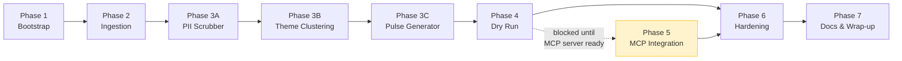

# Implementation Plan — Grow Review AI Agent (MCP)

> **Model:** `openai/gpt-oss-120b` on **Groq** (via `LLM_MODEL` env var)
> **Integration:** MCP-first for Google Docs & Gmail (wired in Phase 5 once MCP server is ready)
> **Language:** Python 3.11+

---

## Overview

| Phase | Name | Goal | Est. Effort |
|-------|------|------|-------------|
| 1 | Project Bootstrap | Scaffold repo, config, and dev environment | 1–2 hrs |
| 2 | Review Ingestion | Fetch & normalise public Groww Play Store reviews | 2–3 hrs |
| 3 | Processing Pipeline | PII scrubbing → theme clustering → pulse generation | 4–6 hrs |
| 4 | Local Output (Dry Run) | Print/save pulse locally to validate end-to-end | 1 hr |
| 5 | MCP Integration | Wire Google Docs + Gmail MCP servers (when ready) | 3–4 hrs |
| 6 | Hardening & Tests | Edge cases, error handling, unit tests | 3–4 hrs |
| 7 | Documentation & Wrap-up | README, usage guide, final review | 1–2 hrs |

---

## Phase 1 — Project Bootstrap

**Goal:** Establish the full repository structure, configuration, and a working Python environment.

### Tasks

- [ ] **1.1** Create the directory structure as defined in `architecture.md §5`
  ```
  src/ingestion/   src/processing/   src/mcp/   src/utils/
  tests/           config/           docs/
  ```
- [ ] **1.2** Create `.env.example` with all required env vars:
  ```
  LLM_MODEL=openai/gpt-oss-120b
  GROQ_API_KEY=...
  GROWW_APP_ID=com.nextbillion.groww
  REVIEW_LOOKBACK_WEEKS=10
  REVIEW_MAX_COUNT=500
  PULSE_RECIPIENT_EMAIL=you@yourteam.com
  ```
- [ ] **1.3** Create `requirements.txt`:
  ```
  groq>=0.9.0
  python-dotenv>=1.0.0
  google-play-scraper>=1.2.4
  pydantic>=2.0.0
  rich>=13.0.0
  pytest>=8.0.0
  pytest-mock>=3.12.0
  ```
- [ ] **1.4** Create `src/utils/config.py` — centralised config loader using `python-dotenv`
- [ ] **1.5** Create all `__init__.py` stubs for each package
- [ ] **1.6** Set up a Python virtual environment and install dependencies
  ```bash
  python -m venv .venv
  source .venv/bin/activate   # Windows: .venv\Scripts\activate
  pip install -r requirements.txt
  ```
- [ ] **1.7** Create `.gitignore` (exclude `.env`, `.venv/`, `__pycache__/`, `*.pyc`)

### Exit Criteria
- `python -c "import openai; import google_play_scraper; print('OK')"` runs without error
- `src/utils/config.py` loads and prints env vars correctly

---

## Phase 2 — Review Ingestion

**Goal:** Pull the last 8–12 weeks of public Groww Play Store reviews and normalise them into a typed schema — with no PII stored.

### Files to Create

| File | Purpose |
|------|---------|
| `src/ingestion/models.py` | `Review` Pydantic model |
| `src/ingestion/fetcher.py` | Fetches reviews via `google-play-scraper` |

### Tasks

- [ ] **2.1** Define the `Review` Pydantic model in `models.py`:
  ```python
  class Review(BaseModel):
      id: str          # SHA-256 of review text (no PII key)
      rating: int      # 1–5
      date: date
      text: str
      title: str | None = None
  ```
- [ ] **2.2** Implement `fetcher.py` → `fetch_reviews(app_id, lookback_weeks, max_count) -> list[Review]`
  - Use `google_play_scraper.reviews()` with `lang="en"`, `country="in"`
  - Filter to reviews within the configured lookback window
  - Strip reviewer name at ingest time (never store it)
  - Deduplicate by `id` (SHA-256 of text)
- [ ] **2.3** Add basic logging with `rich` to show fetch progress
- [ ] **2.4** Manual smoke test: run `fetcher.py` directly and inspect the first 5 reviews

### Exit Criteria
- `fetch_reviews("com.nextbillion.groww", lookback_weeks=10)` returns a non-empty list of `Review` objects
- No reviewer names or other PII appear in the output
- Reviews are within the configured date window

---

## Phase 3 — Processing Pipeline

**Goal:** Transform raw reviews into a structured weekly pulse using `openai/gpt-oss-120b`.

### 3A — PII Scrubber

| File | Purpose |
|------|---------|
| `src/processing/scrubber.py` | Strips PII from review text before LLM processing |

- [ ] **3A.1** Define `CleanReview` model (same as `Review` but text field is guaranteed PII-free)
- [ ] **3A.2** Implement `scrub(reviews: list[Review]) -> list[CleanReview]`:
  - Regex patterns to remove: email addresses, phone numbers, UPI IDs, device model strings
  - Replace matched patterns with `[REDACTED]`
  - Drop reviews where >50% of text is redacted (likely low-signal)
- [ ] **3A.3** Unit test: assert scrubber removes a planted email address from sample text

### 3B — Theme Clustering Engine

| File | Purpose |
|------|---------|
| `src/processing/clusterer.py` | Calls `openai/gpt-oss-120b` via Groq to assign themes |
| `src/utils/prompts.py` | Prompt templates |

- [ ] **3B.1** Define `ThemeCluster` model:
  ```python
  class ThemeCluster(BaseModel):
      name: str                  # e.g. "Payments"
      review_ids: list[str]
      count: int
      summary: str               # 1–2 sentence LLM summary of the cluster
  ```
- [ ] **3B.2** Write the clustering prompt in `prompts.py`:
  - Instructs model to use at most 5 themes from candidate list
  - Returns strict JSON: `{"clusters": [{"name": ..., "review_ids": [...]}]}`
- [ ] **3B.3** Implement `cluster_themes(reviews: list[CleanReview]) -> list[ThemeCluster]`:
  - Batch reviews into chunks if count > 200 (to stay within Groq token limits)
  - Call `groq_client.chat.completions.create(model=config.LLM_MODEL, ...)` using the `groq` SDK
  - Parse and validate JSON response with Pydantic
  - Enforce max 5 themes post-parse (merge overflow into nearest cluster)
- [ ] **3B.4** Unit test with a mock Groq response

### 3C — Pulse Generator

| File | Purpose |
|------|---------|
| `src/processing/pulse_generator.py` | Builds the final weekly pulse from clusters |

- [ ] **3C.1** Define `WeeklyPulse` model:
  ```python
  class WeeklyPulse(BaseModel):
      week_ending: date
      top_themes: list[ThemeCluster]   # Top 3 by review count
      user_quotes: list[str]           # 3 verbatim quotes (PII-free)
      action_ideas: list[str]          # 3 LLM-generated action ideas
      word_count: int
  ```
- [ ] **3C.2** Implement `generate_pulse(clusters, clean_reviews) -> WeeklyPulse`:
  - Select top 3 clusters by `count`
  - Pick 1 representative verbatim quote per top theme (direct from `clean_reviews[]`)
  - Call LLM to generate 3 action ideas grounded in the top themes
  - Enforce ≤250 words on the final rendered pulse; truncate/re-prompt if needed
- [ ] **3C.3** Implement `render_pulse(pulse: WeeklyPulse) -> str` — converts to human-readable Markdown
- [ ] **3C.4** Unit test: assert pulse has exactly 3 quotes, 3 action ideas, top_themes ≤ 3

### Exit Criteria
- Full pipeline `fetch → scrub → cluster → generate_pulse` runs end-to-end
- Output is a valid `WeeklyPulse` with ≤250-word rendered Markdown
- No PII visible in any field

---

## Phase 4 — Local Dry-Run Output

**Goal:** Validate the full pipeline locally before touching any external service.

### Files to Create

| File | Purpose |
|------|---------|
| `src/agent.py` | Orchestrator that wires the full pipeline |

- [ ] **4.1** Implement `agent.py` with a `run()` function:
  ```
  fetch_reviews() → scrub() → cluster_themes() → generate_pulse()
     → render_pulse() → [STUB: deliver via MCP]
  ```
- [ ] **4.2** In the MCP delivery step, use a **local stub** that:
  - Saves rendered pulse to `output/pulse_YYYY-MM-DD.md`
  - Prints the pulse to stdout with `rich`
- [ ] **4.3** Add a `__main__` block so the agent runs with `python -m src.agent`
- [ ] **4.4** Run the full pipeline against live Groww reviews and inspect output

### Exit Criteria
- `python -m src.agent` completes without errors
- `output/pulse_<date>.md` is created with valid content
- Pulse word count ≤ 250, 3 quotes, 3 action ideas visible in output

---

## Phase 5 — MCP Integration *(awaiting MCP server)*

**Goal:** Replace local stubs with real MCP calls to Google Docs and Gmail.

> ⚠️ **This phase is blocked until the MCP server is built and running.**
> The code is structured so Phase 4 stubs are swapped for real MCP clients here with zero changes to the pipeline itself.

### Files to Create / Update

| File | Purpose |
|------|---------|
| `config/mcp_servers.json` | MCP server endpoint config |
| `src/mcp/router.py` | Dispatches to correct MCP server by action type |
| `src/mcp/docs_mcp.py` | Google Docs MCP client wrapper |
| `src/mcp/gmail_mcp.py` | Gmail MCP client wrapper |
| `src/agent.py` | Replace stub delivery with `router.route()` calls |

### Tasks

- [ ] **5.1** Populate `config/mcp_servers.json` with the MCP server URLs / transport config provided by the MCP server build
- [ ] **5.2** Implement `src/mcp/docs_mcp.py`:
  - `create_document(title: str, content: str) -> str` (returns `doc_url`)
  - `append_text(doc_id: str, text: str) -> None`
- [ ] **5.3** Implement `src/mcp/gmail_mcp.py`:
  - `create_draft(to: str, subject: str, body: str) -> str` (returns `draft_id`)
- [ ] **5.4** Implement `src/mcp/router.py` to discover and call the correct MCP server
- [ ] **5.5** Update `src/agent.py` delivery step:
  ```python
  doc_url = mcp_router.create_doc(title, rendered_pulse)
  draft_id = mcp_router.create_gmail_draft(to=config.RECIPIENT, doc_url=doc_url)
  ```
- [ ] **5.6** Add MCP env vars to `.env.example`:
  ```
  GOOGLE_DOCS_MCP_URL=http://localhost:3001
  GMAIL_MCP_URL=http://localhost:3002
  GOOGLE_CLIENT_ID=...
  GOOGLE_CLIENT_SECRET=...
  ```
- [ ] **5.7** End-to-end integration test: verify a real Google Doc is created and a Gmail draft exists

### Exit Criteria
- A Google Doc with the weekly pulse is created in the configured Google account
- A Gmail draft addressed to `PULSE_RECIPIENT_EMAIL` exists with the pulse content or doc link
- No direct Google API / OAuth code exists outside the MCP server itself

---

## Phase 6 — Hardening & Tests

**Goal:** Make the agent robust and production-ready.

### Tasks

- [ ] **6.1** **Error handling** in `fetcher.py` — handle network timeouts, rate limits, empty results
- [ ] **6.2** **LLM fallback** — if the model returns malformed JSON, retry with a stricter prompt (max 2 retries)
- [ ] **6.3** **Token budget guard** — truncate review batch if estimated tokens exceed model context window
- [ ] **6.4** **Word count enforcement** — if rendered pulse > 250 words, re-prompt with explicit word limit
- [ ] **6.5** **MCP error handling** — graceful failure with local file fallback if MCP server is unreachable
- [ ] **6.6** **Write unit tests:**

  | Test File | What It Tests |
  |-----------|--------------|
  | `tests/test_scrubber.py` | PII removal (email, phone, UPI ID patterns) |
  | `tests/test_clusterer.py` | Theme parsing, max-5 enforcement, JSON error retry |
  | `tests/test_pulse_generator.py` | Quote selection, word count, action idea count |
  | `tests/test_fetcher.py` | Date filtering, deduplication, PII exclusion |

- [ ] **6.7** Run `pytest` and achieve > 80% coverage on processing modules
- [ ] **6.8** Lint with `ruff` or `flake8`

### Exit Criteria
- `pytest` passes all tests
- Agent handles no-reviews, LLM timeout, and MCP-down scenarios gracefully
- No PII escapes through any code path (verified by test)

---

## Phase 7 — Documentation & Wrap-up

**Goal:** Make the project hand-off–ready.

### Tasks

- [ ] **7.1** Write `README.md` covering:
  - Project overview
  - Prerequisites (Python 3.11+, API keys)
  - Setup steps (clone → copy `.env.example` → install → run)
  - How to run: `python -m src.agent`
  - How to run tests: `pytest`
  - MCP server integration instructions (link to their docs)
- [ ] **7.2** Final review of `docs/architecture.md` — update any sections that changed during build
- [ ] **7.3** Tag a `v0.1.0` release commit once end-to-end is verified

### Exit Criteria
- A new developer can clone the repo and run the agent by following `README.md` alone
- All docs are consistent with the final implementation

---

## Dependency Graph



> **Phases 1–4** can be completed fully independently of the MCP server.
> **Phase 5** is unblocked the moment you share the MCP server details.

---

## Key Files at Each Phase End

| After Phase | Key Artifacts |
|-------------|--------------|
| 1 | `.env.example`, `requirements.txt`, `src/utils/config.py` |
| 2 | `src/ingestion/fetcher.py`, `src/ingestion/models.py` |
| 3 | `src/processing/scrubber.py`, `clusterer.py`, `pulse_generator.py`, `src/utils/prompts.py` |
| 4 | `src/agent.py`, `output/pulse_<date>.md` |
| 5 | `src/mcp/*.py`, `config/mcp_servers.json` |
| 6 | `tests/test_*.py`, hardened pipeline |
| 7 | `README.md`, final `docs/architecture.md` |
